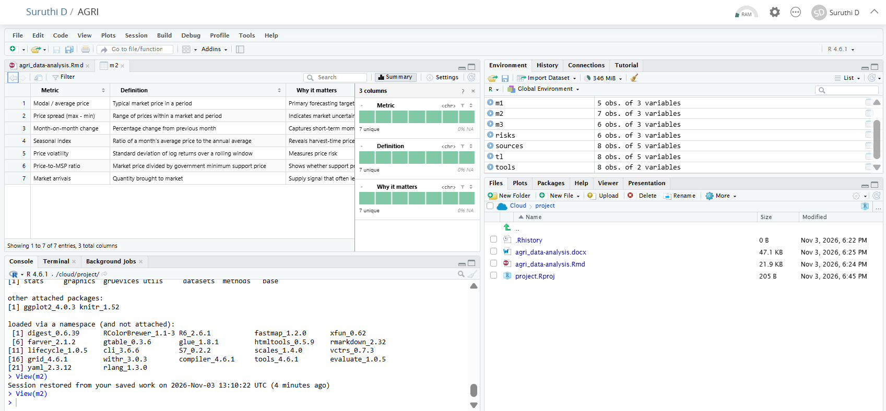

# Agribusiness Data Analysis Planning

A structured plan for collecting and analyzing publicly available agribusiness
data to forecast agriculture market trends.

## Contents
- `agribusiness_data_analysis_plan.Rmd`: R Markdown source of the report
- `agribusiness_data_analysis_plan.docx`: knitted Word report (submitted file)

 ## Screenshot

Fig: Project running in RStudio on Posit Cloud, showing the Rmd file, data objects and knitted
output

## What the plan covers
- Research rationale and objectives
- Public data sources (FAOSTAT, DES India, Agmarknet, USDA, World Bank, IMD, NASA POWER)
- Key metrics: crop yield, pricing dynamics, resource utilization
- Six-stage workflow: scope, collect, clean, explore, model, interpret
- Four-week timeline with milestones, risks and limitations

## Results (Deliverables of the Planning Phase)
This task is a planning exercise, so the results are the completed plan
components, not statistical findings:

- **Data sources:** 8 public sources identified and compared by data type,
  update frequency, format and intended use, with five criteria for evaluating
  each one (relevance, coverage, timeliness, quality, accessibility).
- **Metrics framework:** three groups of indicators defined: crop production
  (yield, area, production), pricing dynamics (modal price, seasonal index,
  volatility, price-to-MSP ratio) and resource utilization (fertilizer use,
  irrigation share, rainfall deviation).
- **Analysis workflow:** a six-stage process, with R code examples for
  collection and cleaning, and a model plan that moves from naive baselines to
  regression and ARIMA, checked using MAE, RMSE and MAPE.
- **Timeline:** a 20-working-day schedule with 8 phases, milestones, a Gantt-style
  chart and review points at the end of each week.
- **Risk management:** 6 risks identified with a mitigation for each.
- **Expected outcomes:** a clean reproducible dataset, trend and seasonality
  insights, short-term price forecasts with uncertainty, and practical
  recommendations for farmers, traders, policy makers and lenders.

## Next steps
Carry out Stage 1 (scoping) and begin the source evaluation, then collect and
clean the data to start the analysis phase.

## How to reproduce
1. Open the `.Rmd` file in RStudio or Posit Cloud.
2. Install packages: `install.packages(c("rmarkdown", "knitr", "ggplot2"))`
3. Click **Knit to Word**.
